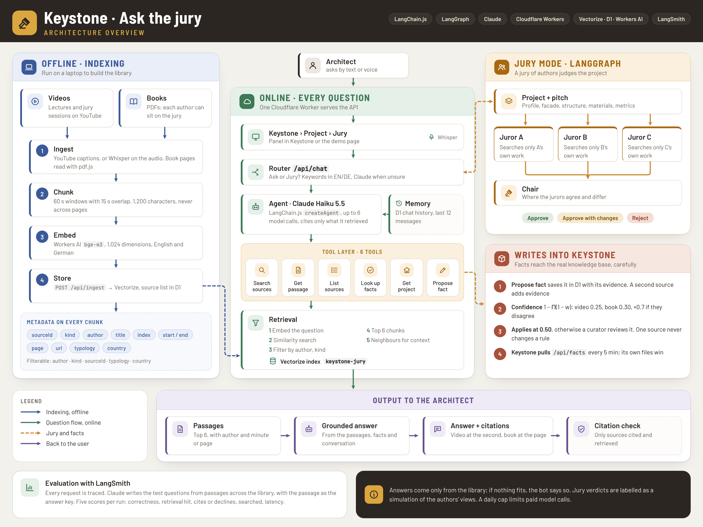

# Keystone jury

*A multimodal AI chatbot for architecture videos and books, with a jury that judges your design.*

Ironhack final project (Project III, *Building a Multimodal AI ChatBot for YouTube Video QA*), built as an extra feature of
[Keystone](https://github.com/roberto-vargas-c/keystone), a web app that designs buildings. Architecture lectures, competition jury
sessions and office talks on YouTube, and architecture books, become a searchable library. You ask it questions by text or voice and
get answers with the minute or page they come from. Or you pick up to three authors from the library as a jury: each judges your
Keystone project only from their own words, and a chair sums up. Design rules the assistant finds go into Keystone's knowledge base.

| | |
|---|---|
| **Live** | `https://keystone-jury.<subdomain>.workers.dev` (demo page), and **Project › Jury** in Keystone |
| **Stack** | LangChain.js + LangGraph.js · Claude Haiku 5.5 · Cloudflare Workers, Vectorize, Workers AI (Whisper, bge-m3), D1 · LangSmith |
| **Code** | `src/` the Worker · `ingest/` the library builder · `eval/` the LangSmith evaluation · `public/` the demo page · `tests/` |

## How the brief maps onto it

| Brief | Here |
|---|---|
| 1. Text QA with pre-trained language models | Claude Haiku 5.5 answers from retrieved passages only, citing each one (`src/agent.ts`) |
| 2. Speech recognition | Whisper large-v3-turbo on Workers AI: spoken questions and pitches (`/api/transcribe`), and videos without captions at ingestion |
| 3. Conversational interface, text or voice | The demo page and Keystone's Jury panel, both with a microphone button; one memory per conversation |
| 4. YouTube content into a vector database | Captions (or Whisper) → cleaned → 60 s windows with 15 s overlap → bge-m3 embeddings → Cloudflare Vectorize, with author, kind, building type, country |
| 5. Testing and evaluation | 19 unit tests (`npm test`) and a LangSmith evaluation of the live app: correctness (LLM judge), retrieval hit, citations, refusals, latency (`eval/run.ts`), on questions it writes itself from the library (`eval/generate.ts`) |
| 6. Agents with several tools and memory | A LangChain agent with 6 tools and D1-backed memory; a LangGraph jury of N jurors and a chair; a router between them |
| LangChain: preprocessing, agents, routing, retrieval | `src/chunk.ts`, `src/agent.ts`, `src/router.ts`, `src/store.ts` (`@langchain/cloudflare` Vectorize store and embeddings) |
| LangSmith | Every request is traced (`LANGSMITH_TRACING`); the evaluation runs as LangSmith experiments to compare settings |
| Deployed as a web app | One Cloudflare Worker serves the API and the demo page; Keystone (also on Cloudflare) calls it |
| Other sources than YouTube | Books (PDF) by page, the same way |

## Architecture



```
 Keystone (Project › Jury)        demo page (public/)
          │  text, voice, project facts  │
          ▼                              ▼
 ┌──────────────────── keystone-jury Worker ─────────────────────┐
 │ /api/transcribe ── Workers AI Whisper                          │
 │ /api/chat ── router ──┬─► Q&A agent (createAgent, 6 tools) ────┼─► Claude Haiku 5.5
 │                       └─► jury graph: jurors ∥ → chair ────────┤
 │ tools: search_sources · get_passage · list_sources ·           │
 │        lookup_facts · get_project · propose_fact               │
 │ memory: D1 (messages per session) · facts and sources: D1      │
 │ /api/facts ─► Keystone merges them into its knowledge base     │
 └───────────────┬───────────────────────────────┬────────────────┘
                 ▼                               ▼
     Vectorize (bge-m3 chunks)          LangSmith (traces, experiments)
                 ▲
   ingest/ (your laptop): YouTube captions or Whisper, book PDFs → chunks → /api/ingest
```

More in [docs/architecture.md](docs/architecture.md).

**The agent's tools**

| Tool | What it does |
|---|---|
| `search_sources` | Semantic search over transcripts and book pages, filtered by author, kind or building type; returns passages with ids like `[abc123:4]` |
| `get_passage` | A passage with the one before and after, when a hit is cut off |
| `list_sources` | The videos, books and authors in the library |
| `lookup_facts` | What Keystone's knowledge base already holds for a country and building type |
| `get_project` | The project open in Keystone: type, place, area, storeys, facade, structure, style, the user's idea |
| `propose_fact` | Writes a design rule into Keystone's knowledge base, backed by a retrieved passage |

**The jury** is a LangGraph graph: `START → jurors → chair → END`. Each juror runs four searches limited to its own author (the project's
idea, facade, structure, site), then answers with a structured verdict (approve, approve with changes, reject) and 2-5 reasons, each tied
to a passage id. A reason citing a passage the juror was not given is dropped. The chair sums up agreement, disagreement and next steps.

**Knowledge base.** A fact is stored in Keystone's shape (`category`, question `q`, country, building type, `en`, `value`, `evidence`).
Its confidence is Keystone's: 1 - Π(1 - weight) over distinct sources, a video counting 0.25 and a book 0.3, × 0.7 when sources
disagree; from 0.5 it applies. So one video or book never changes Keystone's designs alone: it waits under Needs review until a second
source or a curator confirms it.

## Run it

```bash
npm install
cp .dev.vars.example .dev.vars        # ANTHROPIC_API_KEY, INGEST_TOKEN, LANGSMITH_API_KEY
npm test && npm run typecheck
npx wrangler login
npm run dev                            # http://localhost:8787 (Vectorize and Workers AI run remotely)
```

**Deploy.** `bash scripts/setup-cloudflare.sh` creates the Vectorize index and its metadata indexes, the D1 database and its tables,
deploys the Worker and sets its secrets. The workflow `.github/workflows/deploy.yml` runs the same on every push to `main`; add the
repository secrets `CLOUDFLARE_API_TOKEN` (Workers Scripts, D1, Vectorize, Workers AI: Edit), `CLOUDFLARE_ACCOUNT_ID`,
`ANTHROPIC_API_KEY`, `INGEST_TOKEN`, and optionally `LANGSMITH_API_KEY`, `KEYSTONE_BOT_TOKEN` and `OWNER_TOKEN`.

**Fill the library** (from your own machine: YouTube often refuses requests from cloud servers):

```bash
export JURY_URL=https://keystone-jury.<subdomain>.workers.dev INGEST_TOKEN=…
npm run ingest:youtube -- --url "https://www.youtube.com/watch?v=…" --author "Lecturer" --lang en --typology school
npm run ingest:book -- --pdf books/my-book.pdf --author "Author" --title "Title" --offset 12 --lang de --country DE
npm run ingest:book -- --pdf books/copyrighted.pdf --author "Author" --title "Title" --private   # owner-only index
cp ingest/library.example.json ingest/library.json && npm run ingest:library     # everything listed at once
```

**Private books.** A copyrighted book goes in with `--private` (or `"private": true` in `library.json`). It is stored in a second
Vectorize index, `keystone-jury-private`, and marked private in D1. The public endpoints never query it, and `/api/sources` and
`/api/authors` leave it out. A request with `Authorization: Bearer <OWNER_TOKEN>` (or the `INGEST_TOKEN`) searches both indexes,
for asking and for the jury. On the demo page, open it once as `…/#owner=<OWNER_TOKEN>`. Facts proposed from a private book keep
its title and page as evidence but not its text, and an owner's chat history is stored apart from public sessions.

A video without captions: `yt-dlp -x --audio-format mp3 <url>`, then add `--audio file.mp3` (Whisper through the Workers AI REST
API, with `CLOUDFLARE_ACCOUNT_ID` and `CLOUDFLARE_API_TOKEN`).

**Evaluate.** `npm run eval:generate` writes the test questions itself: it reads passages spread over every video and book,
has Claude write a question and reference answer for each (the passage is the reference source), and adds questions the library
cannot answer. Then run `npm run eval -- --dataset keystone-jury-qa-1 --name baseline`.
Hand-written questions in the same format (`eval/dataset.example.jsonl`) can be added. Each run is a LangSmith experiment with five scores per question:
`correctness` (Claude as judge), `retrieval_hit` (a citation from the right video within ±30 s, or the right page), `cites_sources` /
`declined_unanswerable`, `searched`, and `latency_s`.

## API

| | |
|---|---|
| `POST /api/chat` | `{ message, mode?: "auto" \| "ask" \| "jury", sessionId?, project?, jurors?, lang? }`: the router picks |
| `POST /api/ask` | `{ message, sessionId?, project?, lang?, allowWrites? }` → `{ answer, citations[], facts[], tools[] }` |
| `POST /api/jury` | `{ jurors[], project, pitch?, lang? }` → `{ jurors[{ juror, verdict, summary, reasons[], passages[] }], chair }` |
| `POST /api/transcribe` | audio body (webm, ogg, mp3, wav) → `{ text, language }` |
| `GET /api/sources`, `/api/authors` | the library |
| `GET /api/facts` | the facts written into the knowledge base, in Keystone's shape |
| `POST /api/chunks` | `Bearer INGEST_TOKEN`; `{ ids: ["<source>:<n>"] }`, for the question generator |
| `POST /api/ingest` | `Bearer INGEST_TOKEN`; `{ source, segments \| pages \| chunks }` |

Limits: `AI_PER_DAY` paid model calls per day for the whole Worker (default 300), 6 model calls per question, 20 MB per recording.

## Notes

- The jury is a simulation grounded in each author's published words, not their opinion; both interfaces say so.
- Quote books you may use: your own texts, public-domain or openly licensed works, or books you hold the rights to share.
